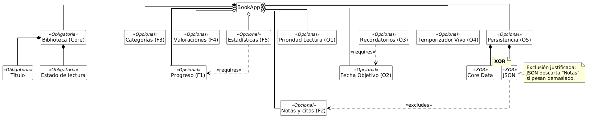

# bookapp-readit

## ReadIt (LPS 2026/27)

| Nombre | Email | GitHub |
| --- | --- | --- |
| Marian Ionut Monda | mm849@inlumine.ual.es | [ualmm849](https://github.com/ualmm849) |
| Sergio Garcia Padial | sgp294@inlumine.ual.es | [sgp294](https://github.com/sgp294) |
| Jesús Montoya Ripoll | jmr007@inlumine.ual.es | [jmr0077](https://github.com/jmr0077) |
| Carmen Maria Peña Sevilla | cps071@inlumine.ual.es | [ualcps071](https://github.com/ualcps071) |
| Adrían Ureña Arróniz | aua441@inlumine.ual.es | [F3rgus](https://github.com/F3rgus) |

## Funcionalidades

| Tipo | Características |
| --- | --- |
| Obligatorio: Core | Libro con identificador, título no vacío, autor (opcional) y estado de lectura; gestión de la biblioteca (alta, consulta, edición, cambio de estado y eliminación) y persistencia local. |
| F1: Progreso | Total de páginas, página actual y porcentaje leído. |
| F2: Notas y citas | Anotaciones personales vinculadas a un libro. |
| F3: Categorías | Clasificación de libros y filtrado de la biblioteca. |
| F4: Valoraciones y reseñas | Puntuación de 1 a 5 estrellas y reseña personal. |
| F5: Estadísticas | Número total de libros y recuento por estado de lectura. |
| Originales | Diez originales y dos características diferentes por cada integrante del equipo. |

## Diagrama de caracterisiticas

