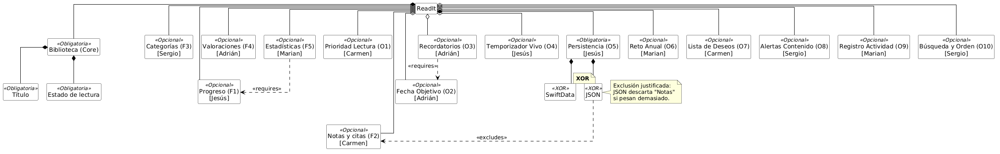

# bookapp-readit

## ReadIt (LPS 2026/27)

| Nombre | Email | GitHub |
| --- | --- | --- |
| Marian Ionut Monda | mm849@inlumine.ual.es | [ualmm849](https://github.com/ualmm849) |
| Sergio Garcia Padial | sgp294@inlumine.ual.es | [sgp294](https://github.com/sgp294) |
| Jesús Montoya Ripoll | jmr007@inlumine.ual.es | [jmr0077](https://github.com/jmr0077) |
| Carmen Maria Peña Sevilla | cps071@inlumine.ual.es | [ualcps071](https://github.com/ualcps071) |
| Adrían Ureña Arróniz | aua441@inlumine.ual.es | [F3rgus](https://github.com/F3rgus) |

## Catálogo de funcionalidades

### Núcleo obligatorio (Core / MVP)
| ID | Característica | Descripción |
| --- | --- | --- |
| **Core** | **Biblioteca básica** | Gestión completa de libros (`id`, `title`, `author` opcional y `state`: *Pendiente*, *Leyendo*, *Terminado*) con alta, listado, edición, cambio de estado y borrado. |

### Funcionalidades comunes (F1 – F5)
| ID | Característica | Trait (`#if`) | Descripción | Responsable |
| --- | --- | --- | --- | --- |
| **F1** | **Progreso** | `Progreso` | Registro de página actual frente al total de páginas y barra de porcentaje leído. | Jesús |
| **F2** | **Notas y citas** | `Notas` | Apuntes personales y citas favoritas vinculadas a cada libro. | Carmen |
| **F3** | **Categorías** | `Categorias` | Clasificación temática por géneros y filtrado de la biblioteca. | Sergio |
| **F4** | **Valoraciones y reseñas** | `Valoraciones` | Puntuación de 1 a 5 estrellas y comentario personal de opinión. | Adrián |
| **F5** | **Estadísticas** | `Estadisticas` | Resumen de libros totales, leídos, porcentaje completado y métricas de lectura. | Marian |

### Funcionalidades opcionales (O1 – O10)
| ID | Característica | Trait (`#if`) | Descripción | Responsable |
| --- | --- | --- | --- | --- |
| **O1** | **Prioridad de lectura** | `Prioridades` | Niveles de prioridad (*Alta*, *Media*, *Baja*) mostrados como píldora en el catálogo. | Carmen |
| **O2** | **Fecha objetivo** | `FechaObjetivo` | Fecha límite configurada para finalizar la lectura de un libro. | Adrián |
| **O3** | **Recordatorios** | `Recordatorios` | Avisos de hábito diario y alertas visuales para libros próximos a vencer. | Adrián |
| **O4** | **Temporizador en vivo** | `Temporizador` | Cronómetro de sesión de lectura (*Iniciar / Pausar / Reiniciar*) y tiempo acumulado. | Jesús |
| **O5** | **Persistencia local (XOR)** | `PersistenciaJSON` / `PersistenciaCoreData` | Almacenamiento permanente alternativo en JSON (`books.json`) o Core Data / Binario (`books.plist`). | Jesús |
| **O6** | **Reto anual de lectura** | `RetoAnual` | Meta configurable de libros al año con barra de progreso. | Marian |
| **O7** | **Lista de deseos** | `ListaDeseos` | Marcado y filtrado de libros pendientes de adquirir (*Wishlist*). | Carmen |
| **O8** | **Alertas de contenido** | `AlertasContenido` | Etiquetas opcionales de aviso sobre contenido sensible en la ficha del libro. | Sergio |
| **O9** | **Registro de actividad** | `RegistroActividad` | Historial y contador de racha de días con actividad lectora. | Marian |
| **O10** | **Búsqueda y ordenación** | `BusquedaOrden` | Búsqueda por título/autor y ordenación dinámica del listado. | Sergio |

### Restricciones cruzadas del modelo
* **`F5 (Estadísticas)`  `<<requires>>` `F1 (Progreso)`**: las métricas avanzadas dependen de los datos de seguimiento de páginas.
* **`O3 (Recordatorios)`  `<<requires>>` `O2 (Fecha Objetivo)`**: los avisos de vencimiento requieren tener fechas objetivo habilitadas.
* **`PersistenciaJSON`  `<<excludes>>` `PersistenciaCoreData` (`XOR`)**: motores mutuamente excluyentes validados en tiempo de compilación (`#error`).
* **`PersistenciaJSON`  `<<excludes>>`

## Diagrama de caracterisiticas

